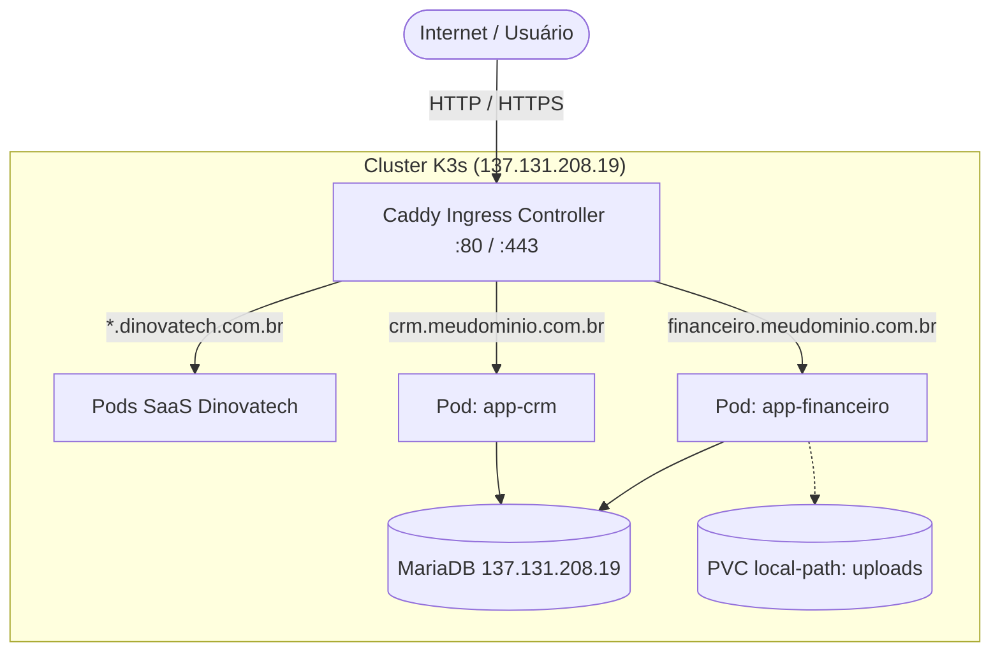

# Tutorial: Como Subir Aplicações e Sistemas Bare-Metal PHP no Cluster K3s

Este guia documenta o passo a passo completo para migrar sistemas bare-metal (sites, CRMs, blogs, ferramentas internas em PHP) para rodar como **Pods conteinerizados no cluster K3s** da Dinovatech (`137.131.208.19`), aproveitando os **11 GB de RAM / 2 vCPUs ARM64** e o **Caddy Ingress** para emissão automática de certificados SSL (HTTPS).

---

## 1. Visão Geral da Arquitetura



* **Vantagens de rodar no K3s**:
  * **Isolamento**: Cada sistema roda em seu próprio namespace, sem interferir no PHP, módulos ou pastas de outros apps.
  * **Zero Custos Extras**: Aproveita os 11 GB de RAM e 48 GB NVMe do cluster OCI Ampere A1 já provisionado.
  * **SSL Automático**: O Caddy Ingress emite e renova certificados Let's Encrypt / ZeroSSL automaticamente via HTTP-01 / TLS-ALPN.
  * **Controle de Recursos**: Limites de memória e CPU configuráveis por pod, impedindo que um app trave o servidor.

---

## 2. Passo 1: Empacotar o Sistema PHP em Imagem Docker

Crie um `Dockerfile` na raiz do código-fonte do sistema que deseja migrar.

Como o nó master é **ARM64 (aarch64)**, reutilize a imagem base já preparada:

```dockerfile
FROM ilunne/php8.3-arm-base:latest

WORKDIR /var/www/html

# 1. Copia o código-fonte da aplicação
COPY . /var/www/html/

# 2. Ajusta permissões para o usuário www-data do Apache
RUN chown -R www-data:www-data /var/www/html \
    && chmod -R 755 /var/www/html

# (Opcional) Permissão de escrita caso haja pasta de uploads/cache local:
# RUN chmod -R 775 /var/www/html/uploads 2>/dev/null || true

EXPOSE 80
CMD ["apache2-foreground"]
```

### Como gerar a imagem:

**Opção A: Gerar direto no nó master K3s (`k3s-master-arm`)**:
```bash
# Na pasta do projeto:
docker build -t meu-sistema:v1.0.0 .

# Importar a imagem do Docker local para o Containerd do K3s:
docker save meu-sistema:v1.0.0 | sudo k3s ctr images import -
```

**Opção B: Gerar via Buildx e enviar para o Docker Hub**:
```bash
docker buildx build --platform linux/arm64 -t seu_usuario/meu-sistema:v1.0.0 . --push
```

---

## 3. Passo 2: Criar o Manifesto Kubernetes

Copie o modelo pronto [devops/k8s/template-app-avulso.yaml](template-app-avulso.yaml) para o seu novo app:

```bash
cp devops/k8s/template-app-avulso.yaml /home/ubuntu/meu-sistema.yaml
```

Edite o arquivo ajustando:
1. O nome do namespace: `app-meu-sistema`
2. As credenciais do banco no `Secret`:
   ```yaml
   stringData:
     DB_HOSTNAME: "137.131.208.19"
     DB_DATABASE: "meu_banco"
     DB_USERNAME: "meu_usuario"
     DB_PASSWORD: "senha_do_banco"
   ```
3. A imagem no `Deployment`: `meu-sistema:v1.0.0`
4. (Se o sistema gravar arquivos no disco) Descomente o `PersistentVolumeClaim` e o `volumeMounts`.

Aplique no cluster:
```bash
kubectl apply -f meu-sistema.yaml
```

Verifique se o pod subiu com sucesso:
```bash
kubectl get pods -n app-meu-sistema
kubectl logs -n app-meu-sistema deployment/meu-app-deployment
```

---

## 4. Passo 3: Expor o Domínio no Caddy Ingress (HTTPS com SSL Automático)

Para que o domínio (ex: `financeiro.meudominio.com.br`) aponte com segurança para o pod:

1. **Aponte o DNS** (Registro tipo `A` ou `CNAME`) do domínio para o IP público do cluster: `137.131.208.19`.
2. **Edite o ConfigMap do Caddy Ingress**:
   ```bash
   kubectl edit configmap caddy-config -n ingress-caddy
   ```
3. **Adicione o bloco do seu domínio** antes do bloco de fallback `:80` e `:443`:
   ```caddyfile
   financeiro.meudominio.com.br {
       reverse_proxy meu-app-service.app-meu-sistema.svc.cluster.local:80 {
           header_up Host {http.request.host}
           header_up X-Real-IP {http.request.header.X-Forwarded-For}
           header_up X-Forwarded-Proto https
       }
   }
   ```
4. **Recarregue a configuração do Caddy** (sem downtime):
   ```bash
   kubectl exec -n ingress-caddy deployment/caddy-ingress -- caddy reload --config /etc/caddy/Caddyfile
   ```

Pronto! Ao acessar `https://financeiro.meudominio.com.br`, o Caddy emite o certificado SSL Let's Encrypt na hora e encaminha para o seu container.

---

## 5. Dicas para Sistemas Legados

### A. Uploads e Arquivos em Disco (Persistência)
Se o sistema legado não usa S3 e grava uploads direto no disco local (ex: `/var/www/html/uploads`):
- O K3s possui por padrão o StorageClass `local-path`.
- O manifesto `template-app-avulso.yaml` já inclui o `PersistentVolumeClaim` de 5GB pronto.
- Os arquivos ficam salvos em `/var/lib/rancher/k3s/storage/` no disco NVMe do nó master, sobrevivendo a reinicializações e updates de pods.

### B. Consumo do WeasyPrint para Geração de PDFs
Se o seu sistema avulso também precisa gerar PDFs via HTML, você **não precisa instalar nada pesado**:
Basta apontar o endpoint HTTP para o serviço centralizado já existente no cluster:
```
http://weasyprint.shared-services.svc.cluster.local:9080/convert/html
```

### C. Comandos Úteis do Dia a Dia

```bash
# Ver todos os pods rodando no cluster:
kubectl get pods -A

# Ver consumo de CPU e Memória por pod:
kubectl top pods -A

# Acessar o terminal bash dentro do container:
kubectl exec -it -n app-meu-sistema deployment/meu-app-deployment -- bash

# Reiniciar o pod para forçar atualização:
kubectl rollout restart deployment/meu-app-deployment -n app-meu-sistema

# Ver logs de erro do Apache/PHP em tempo real:
kubectl logs -f -n app-meu-sistema deployment/meu-app-deployment
```
