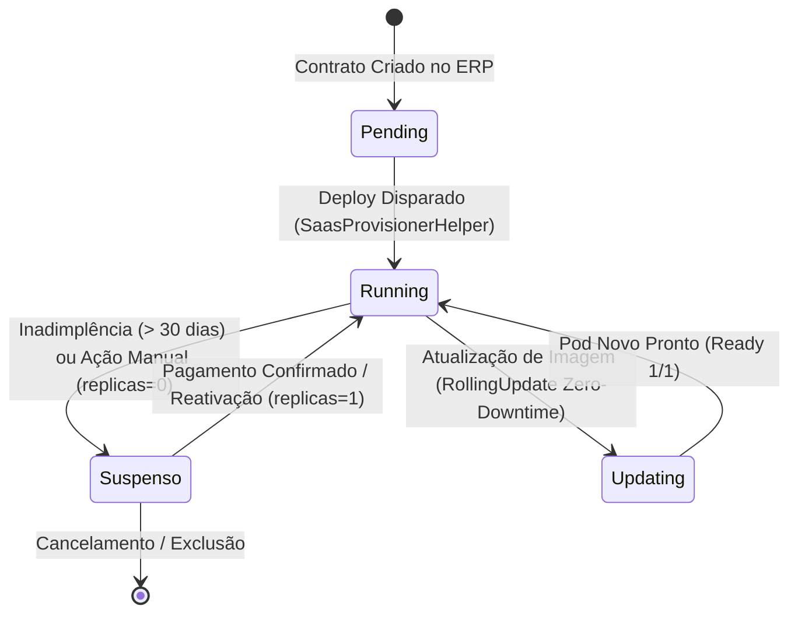

# Arquitetura e Implementação: SaaS Multi-Tenant por Isolamento de Containers (K3s)

Este documento consolida a arquitetura técnica, a infraestrutura implementada e o status da plataforma **Dinovatech SaaS**, preservando a base de código PHP existente e isolando clientes via orquestração de containers dedicados (**Container-per-Tenant**).

---

## 1. Decisão Estratégica de Arquitetura

### 1.1 Diagnóstico do Sistema
* O sistema é estruturado em PHP procedural/estruturado com queries manuais SQL (`DBExecute`, `mysqli_query`).
* Possui forte acoplamento com recursos sensíveis por cliente:
  * **Módulo Fiscal (NFS-e)**: Certificados A1 (`.pfx`), chaves privadas, senhas e controle sequencial de RPS/Lotes.
  * **Financeiro & Webhooks**: Integrações (InfinitePay, Google Calendar) e crons de recorrência.
  * **Módulo Veterinário / Outros Modos**: Alternância de modo via variáveis de ambiente (`APP_MODE_VET`).
  * **Chaves de Criptografia**: Chave mestra dedicada por cliente (`APP_MASTER_KEY`).

### 1.2 Comparativo: Container-per-Tenant vs. SaaS Monolítico (Banco Compartilhado)

| Critério | Multi-Tenant por Container (Implementado) | SaaS Monolítico (Banco Único) |
| :--- | :--- | :--- |
| **Time to Market** | **Imediato** | **Longo (3 a 6 meses)** |
| **Refatoração de SQL** | **Zero** — Código roda como está hoje | **Massiva** — Adicionar `WHERE tenant_id = ?` em centenas de arquivos |
| **Risco LGPD / Vazamento** | **Nulo** — Bancos e processos 100% isolados | **Alto** — Uma falha de query expõe dados de outro cliente |
| **Certificados Fiscais A1** | **Seguro e Simples** (armazenado por container) | **Complexo** (múltiplos certificados em concorrência de sessão) |
| **Controle de Inadimplência**| **Nível de Infraestrutura** (`scale replicas=0`) | **Nível de Código** (middlewares e flags em banco) |
| **Customização por Cliente** | **Alta** (limites de CPU/RAM, ENVs e flags customizadas) | **Baixa** (todas as contas compartilham o mesmo runtime) |

---

## 2. Topologia de Infraestrutura do Cluster K3s

O ambiente de execução dos clientes é orquestrado no nó **K3s Master ARM64** hospedado na Oracle Cloud:

```mermaid
flowchart TD
    Internet([Tráfego Externo - HTTP/3, HTTP/2, HTTPS]) -->|Portas 80 / 443| CaddyIngress

    subgraph ClusterK3s["Cluster K3s ARM64 (137.131.208.19)"]
        subgraph IngressNS["Namespace: ingress-caddy"]
            CaddyIngress["Caddy Ingress (On-Demand TLS)\nReverse Proxy Dinâmico Regex"]
        end

        subgraph SharedNS["Namespace: shared-services"]
            WeasyPrint["WeasyPrint REST API\n(Porta 9080 ClusterIP)\nCompartilhado para PDFs"]
        end

        subgraph Tenant1["Namespace: tenant-clinica-alfa"]
            Pod1["Pod: app-clinica-alfa\n(PHP 8.2 Apache)"]
            Secret1["Secret: tenant-env\n(DB_*, APP_MODE_VET, etc.)"]
            Svc1["Service: app-clinica-alfa:80"]
        end

        subgraph Tenant2["Namespace: tenant-pet-beta"]
            Pod2["Pod: app-pet-beta\n(PHP 8.2 Apache)"]
            Secret2["Secret: tenant-env\n(DB_*, APP_MODE_VET, etc.)"]
            Svc2["Service: app-pet-beta:80"]
        end
    end

    subgraph DataTier["Camada de Dados & Bancos"]
        MariaDBServer[("MariaDB Centralizado / Remoto\n- dino_clinica_alfa\n- dino_pet_beta")]
    end

    subgraph ERPAdmin["ERP Master Dinovatech (Admin)"]
        AdminPainel["Central SaaS (saas_tenants.php) &\nContratos / Serviços"]
    end

    CaddyIngress -->|clinica-alfa.dinovatech.com.br| Svc1
    CaddyIngress -->|pet-beta.dinovatech.com.br| Svc2
    Svc1 --> Pod1
    Svc2 --> Pod2

    Pod1 -->|cURL PDF| WeasyPrint
    Pod2 -->|cURL PDF| WeasyPrint

    Pod1 -->|Conexão DB| MariaDBServer
    Pod2 -->|Conexão DB| MariaDBServer

    AdminPainel -.->|REST API K3s (Porta 6443)| ClusterK3s
```

### 2.1 Especificações do Nó K3s
- **Instância**: OCI Ampere ARM64 (`k3s-master-arm`).
- **IP Público**: `137.131.208.19`
- **Hardware**: 2 OCPUs ARM64 (`Neoverse-N1`), 11 GiB RAM livre, 48 GB NVMe.
- **SO & Versão**: Ubuntu 26.04 LTS aarch64 | K3s `v1.36.5+k3s1` (containerd 2.3.4).
- **TLS-SAN**: `137.131.208.19` (comunicação segura com token Bearer na porta 6443).

### 2.2 Roteamento Dinâmico com Caddy Ingress (devops/k8s/01-caddy-ingress.yaml)
* O Caddy substituiu o Traefik/Ingress-Nginx legado.
* **On-Demand TLS**: Emissão automática de certificados SSL (Let's Encrypt / ZeroSSL) na primeira requisição HTTP sem necessidade de criar recursos `Certificate` manuais.
* **Upstream Dinâmico**: O Caddy extrai o `{slug}` do hostname via regex e despacha direto para o Service interno do Kubernetes:
  ```caddy
  @tenant {
      header_regexp host Host ^(?P<slug>[a-z0-9-]+)\.dinovatech\.com\.br$
  }
  handle @tenant {
      reverse_proxy app-{re.host.slug}.tenant-{re.host.slug}.svc.cluster.local:80 {
          header_up Host {http.request.host}
          header_up X-Real-IP {http.request.header.X-Forwarded-For}
          header_up X-Forwarded-Proto {http.request.scheme}
      }
  }
  ```

### 2.3 Microserviço WeasyPrint Centralizado (devops/k8s/02-weasyprint-shared.yaml)
* Rodando no namespace `shared-services` (porta 9080 ClusterIP).
* Todos os pods de tenants enviam o HTML via cURL para `http://weasyprint.shared-services.svc.cluster.local:9080/convert/html`.
* **Economia**: Evita alocar ~250 MB de RAM em cada Pod de cliente apenas para compilar PDFs.

---

## 3. Modelo Operacional: Database-per-Tenant

Para maximizar densidade e reduzir custos de memória:
* **Um servidor MariaDB gerenciado** (OCI ou dedicado).
* **Bancos de Dados Isolados**: Cada tenant recebe um banco exclusivo (`dino_{slug}`), com credenciais isoladas.
* **Flexibilidade de Infraestrutura**: O contrato do tenant permite especificar `db_host` e `db_port`, viabilizando bancos remotos externos, instâncias dedicadas para grandes clientes ou o banco central padrão (`SAAS_DEFAULT_DB_HOST`).
* Os containers PHP consomem apenas ~25 MB a 40 MB de RAM em repouso.

---

## 4. Orquestração, Elasticidade e Zero-Downtime

### 4.1 RollingUpdate com Zero-Downtime
Implementado na classe `SaasProvisionerHelper`:
* **Estratégia**:
  ```yaml
  strategy:
    type: RollingUpdate
    rollingUpdate:
      maxSurge: 1
      maxUnavailable: 0
  ```
* **Readiness Probe**:
  * Valida `HTTP GET /login.php:80` com `initialDelaySeconds: 5`, `periodSeconds: 5`, `timeoutSeconds: 3`.
  * O Kubernetes primeiro inicializa o novo pod da nova versão/imagem.
  * O tráfego só é chaveado para o novo pod quando o `readinessProbe` responder status HTTP 200.
  * O pod antigo só é encerrado com `SIGTERM` após a prontidão confirmada da nova réplica.

### 4.2 Elasticidade de Recursos (Requests vs Limits)
Configurável individualmente por contrato ou herdado do template do Serviço:
* **Requests (Mínimo Garantido)**:
  * `cpu: 50m`
  * `memory: 64Mi`
* **Limits (Teto Máximo de Burst)**:
  * `cpu: 250m` (ou configurado no contrato/serviço)
  * `memory: 128Mi` (ou configurado no contrato/serviço)

### 4.3 Injeção Dinâmica de Configurações (Secret `tenant-env`)
Cada tenant possui um Secret Kubernetes com:
* `DB_HOSTNAME`, `DB_PORT`, `DB_DATABASE`, `DB_USERNAME`, `DB_PASSWORD`
* `APP_MODE_VET`: `true` ou `false`
* `APP_MASTER_KEY`: chave criptográfica mestra
* `custom_envs`: variáveis adicionais informadas linha a linha no formato `CHAVE=VALOR`
* `WEASYPRINT_URL`: apontando para o serviço central compartilhado

---

## 5. Ciclo de Vida do Cliente e Inadimplência



* **Suspensão (scale=0)**:
  * Libera 100% da memória e CPU do Pod no cluster.
  * Mantém banco de dados e arquivos intactos.
  * Caddy redireciona ou entrega página informativa.
* **Reativação (scale=1)**:
  * O container sobe novamente em menos de 5 segundos.

---

## 6. Módulos e Componentes Desenvolvidos no ERP

### 6.1 Backend Core
* **`dinovatech/config.php` & `.env.example`**:
  * Flags: `SAAS_MASTER_ENABLED`, `K3S_API_URL`, `K3S_API_TOKEN`, `K3S_INSECURE_SKIP_TLS`, `K3S_DEFAULT_IMAGE`, `SAAS_DEFAULT_DB_HOST`.
* **`dinovatech/helpers/K3sClientHelper.php`**:
  * Wrapper cURL nativo em PHP para a API REST do Kubernetes (6443) sem necessidade de binários `kubectl` ou chamadas SSH no host do ERP.
* **`dinovatech/helpers/SaasProvisionerHelper.php`**:
  * Métodos: `provisionTenant()`, `scaleTenant()`, `updateTenantImage()`, `getTenantLogs()`, `getTenantStatus()`.
* **`dinovatech/app.php`**:
  * Endpoints AJAX: `saas_provision_pod`, `saas_scale_pod`, `saas_update_image`, `saas_get_pod_logs`.

### 6.2 Banco de Dados
* **`database/migrations/20261022_0001_add_saas_multi_tenant_schema.sql`**: Tabela `saas_tenants` e campos de template em `Servicos`.
* **`database/migrations/20261022_0002_add_db_host_to_saas_tenants.sql`**: Campos `db_host` e `db_port`.
* **`database/migrations/20261022_0003_add_env_fields_to_saas_tenants.sql`**: Campos `app_mode_vet`, `app_master_key` e `custom_envs`.

### 6.3 Telas e Interfaces
* **`dinovatech/servico_form.php` & `dinovatech/servicos.php`**:
  * Cadastro de serviços SaaS com configuração padrão de imagem Docker, memória e CPU.
* **`dinovatech/contrato_form.php` & `dinovatech/contratos.php`**:
  * Geração automática de slug a partir do nome do cliente.
  * Configuração de subdomínio, banco, host/porta, modo veterinário, chave mestra e variáveis extras.
  * Painel com status do Pod K3s e botões de ação direta.
* **`dinovatech/saas_tenants.php` (Central SaaS)**:
  * Dashboard com KPIs: Total de Instâncias, Pods Running, Instâncias Suspensas e MRR Contratado.
  * Tabela interativa com filtros e botões de ação:
    * 🚀 Deploy / Provisionar
    * ⏸️ Suspender / ▶️ Reativar
    * 🔄 Atualizar Versão (Modal com input de nova tag e disparo de RollingUpdate)
    * 📋 Ver Logs (Terminal em modal com saída do pod em tempo real)
  * Painel retrátil de diagnóstico da saúde do cluster K3s ARM64.

---

## 7. Status do Roadmap de Implementação

### ✅ Concluído
- [x] Provisionamento e hardening do nó K3s ARM64 (`137.131.208.19`).
- [x] Implantação do Caddy Ingress com On-Demand TLS e upstream dinâmico por regex.
- [x] Implantação do microserviço compartilhado WeasyPrint no namespace `shared-services`.
- [x] Migrations de banco de dados (`20261022_0001`, `0002`, `0003`).
- [x] Cliente HTTP REST do K3s (`K3sClientHelper.php`) com suporte a cURL e Strategic Merge Patch.
- [x] Orquestrador de provisionamento, escala, logs e RollingUpdate zero-downtime (`SaasProvisionerHelper.php`).
- [x] Painel Central de Gestão SaaS (`dinovatech/saas_tenants.php`) com métricas e diagnóstico do cluster.
- [x] Formulários de Serviços e Contratos com suporte a templates SaaS, modo veterinário e variáveis de ambiente.

### ⏳ Próximas Etapas
- [ ] **Build e Publicação da Imagem Base ARM64**:
  * Compilar `devops/Dockerfile` para arquitetura `linux/arm64` (`dinovatech:latest`) e publicar em registry (Docker Hub ou GitHub Container Registry) ou importar no containerd do nó.
- [ ] **Runner Automatizado de Banco para Novo Tenant**:
  * Ao criar o tenant no ERP, executar script que roda `CREATE DATABASE IF NOT EXISTS dino_{slug}` e executa as migrações iniciais para deixar as tabelas prontas.
- [ ] **Automação de Suspensão por Webhook da InfinitePay**:
  * Quando a fatura do contrato passar de 30 dias em atraso, chamar `SaasProvisionerHelper::scaleTenant($id, 0)` automaticamente.
- [ ] **Rotina Centralizada de Backup de Bancos dos Tenants**:
  * Cron noturno executando mysqldump de todas as bases `dino_*` com envio para o Oracle Object Storage.
